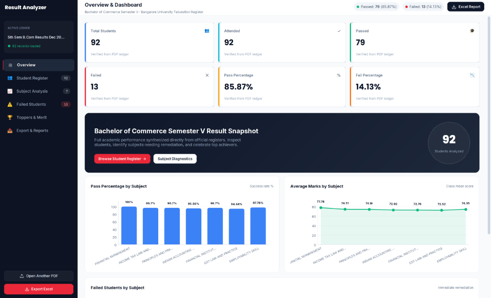

# Score-Lens

A high-performance, 100% offline desktop application built to parse, analyze, and visualize academic examination result ledgers and tabulation PDFs from any university or educational board. Upload raw PDF marksheets to instantly generate an interactive analytics dashboard featuring class rankings, subject-level breakdowns, statistical grade distributions, backlog tracking, and multi-sheet Excel exports.

[](https://www.python.org/)
[](https://github.com/TomSchimansky/CustomTkinter)
[](https://github.com/SahilPathan18/Score-Lens)
[](LICENSE)
[](https://github.com/SahilPathan18/Score-Lens)



---

## 🌟 Key Features

- **Universal Multi-Format PDF Ingestion** — Geometry-aware table matrix detection and adaptive parsing capable of processing diverse university and institutional formats (Bangalore University, UUCMS/NEP, VTU, State & Central Universities, and autonomous marks cards).
- **Universal Roll Number Recognition** — Dynamically matches numeric (7–14 digit roll numbers), alphanumeric (USNs, seat codes), and institutional slashed IDs (`21/BCA/042`).
- **Semantic Column Classification** — Automatically classifies columns to extract student names, course codes, course titles, theory/practical/internal marks, totals, SGPA, CGPA, and pass/fail statuses.
- **Smart Cohort Segmentation** — Automatically isolates regular current-semester students from backlog repeaters for accurate batch performance analytics.
- **Interactive Analytics Dashboard** — Instant calculation of class pass percentages, average SGPA/CGPA, semester toppers, subject toppers, and embedded Matplotlib visual distributions.
- **Student Record Explorer** — Instant search by Student Name or Register Number with multi-attribute filtering (PASS, FAIL, ABSENT, PROMOTED).
- **Subject-Wise Deep Dive** — Granular course analysis covering pass percentages, averages, failure counts, and automatic re-registration backlog lists.
- **Multi-Sheet Excel Export** — Direct generation of formatted `.xlsx` workbooks containing master ledgers, subject summaries, rank lists, and backlog rosters via openpyxl.
- **100% Offline & Private** — Operates entirely on-device with zero cloud dependencies; sensitive student academic records never leave your computer.

---

## 📋 Supported Formats & Extraction Architecture

Score-Lens dynamically analyzes incoming PDF geometry using a 4-tier fallback parsing pipeline:

| Format Pipeline | Target Document Styles | Parsing Mechanism |
|---|---|---|
| **Grid Table Matrix** | Multi-row headers, students as rows, subjects as column groups | PyMuPDF `find_tables()` geometry-aware cell matrix with semantic header inference |
| **UUCMS / NEP Format** | Karnataka collegiate NEP mark ledgers sectioned by student blocks | Custom block delimiter & subject code regex extractors |
| **Standard Alphanumeric / Roll Number** | VTU, Central/State universities, dense register sheets | Heuristic column alignment & universal roll number pattern matching |
| **Universal Adaptive Fallback** | Any custom marksheet, autonomous grading sheets, slashed IDs | Coordinate-sorted spatial text reconstruction |

---

## 🚀 Quick Start

### 1. Portable Edition (No Python Required)
1. Download or build `ResultAnalyzer-Portable.zip`.
2. Extract the archive.
3. Double-click **`Start Result Analyzer.bat`** to run.
*(Optional: Run `Create Desktop Shortcut.bat` inside the folder to add a desktop shortcut with the app icon).*

### 2. Run from Source

**Prerequisites:** Python 3.10+ on Windows.

```bash
# Clone the repository
git clone https://github.com/SahilPathan18/Score-Lens.git
cd Score-Lens

# Create and activate virtual environment
python -m venv venv
.\venv\Scripts\Activate.ps1

# Install dependencies and run
pip install -r requirements.txt
python src/main.py
```

---

## 🛠️ Building Standalone Binaries (`dist/`)

To compile the standalone setup installer (`ResultAnalyzerSetup.exe`) and the zero-install portable zip (`ResultAnalyzer-Portable.zip`):

```powershell
powershell -ExecutionPolicy Bypass -File scripts\build.ps1
```

All compiled binaries will be generated in the `dist/` directory.

---

## 💻 Tech Stack

- **UI Framework:** [CustomTkinter](https://github.com/TomSchimansky/CustomTkinter) *(Modern Dark/Light desktop interface)*
- **PDF Extraction Engine:** [PyMuPDF](https://pymupdf.readthedocs.io/) *(Geometry-aware table grid extraction)*
- **Data Processing & Analytics:** [Pandas](https://pandas.pydata.org/) & [NumPy](https://numpy.org/)
- **Visualizations:** [Matplotlib](https://matplotlib.org/)
- **Excel Generation:** [openpyxl](https://openpyxl.readthedocs.io/)
- **Packaging & Executables:** [PyInstaller](https://pyinstaller.org/)

---

## 🏷️ Recommended GitHub Topics

`python` • `pdf-parser` • `analytics-dashboard` • `results-analyzer` • `customtkinter` • `pymupdf` • `academic-records` • `education-technology` • `offline-first` • `data-visualization`
